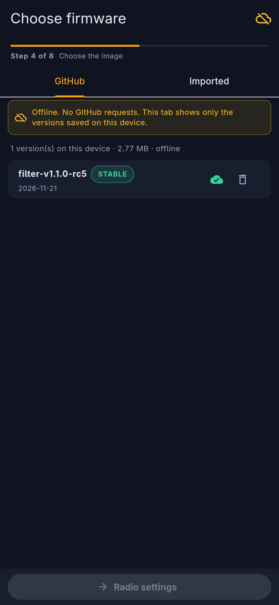

# MeshCoreRepeaterManager

<p align="center">
  
</p>

**MeshCoreRepeaterManager updates MeshCore repeater firmware over the air, from your phone
or laptop: no tower visit, no laptop at the site, and no extra traffic across
your mesh.**

A repeater on a hill, a roof or a water tower is hard to reach and easy to
put off updating. Plugging in a USB cable means a climb, a ladder or a drive.
MeshCoreRepeaterManager lets an authorised operator send a release to that repeater
through a MeshCore companion that is already on the mesh. The repeater
verifies the image, stores it in its spare firmware slot, and only boots it
when you say so. If the new firmware cannot start its radio, the repeater
flips back to the one that worked, by itself.

The app is a companion for the **[MeshCore](https://github.com/meshcore-dev/MeshCore)
repeater firmware fork**; the over-the-air feature is part of that firmware.
The companion device stays on its stock firmware.

## Download

Releases are on the
**[MeshCoreRepeaterManager releases page](https://github.com/jhuebert/MeshCoreRepeaterManager/releases)**:

| Platform | What to download | Notes |
|---|---|---|
| Android | `MeshCoreRepeaterManager-<version>-universal.apk` | Sideload it; play services are not needed. |
| Linux | `MeshCoreRepeaterManager-<version>-linux-x64.tar.gz` | Unpack and run `meshcorepeatermanager`. |
| Windows | `MeshCoreRepeaterManager-<version>-windows-x64.zip` | Unpack and run `meshcore_repeater_manager.exe`. |
| macOS | `MeshCoreRepeaterManager-<version>-macos.zip` | Unpack and open `meshcore_repeater_manager.app`. |

The desktop builds are unsigned: Windows SmartScreen and macOS Gatekeeper
will ask you to confirm the first launch. Android installs are signed with
the project's app key, so upgrading an existing install keeps your data.

## What you need

- A repeater running the **update-enabled MeshCore fork**: see
  [jhuebert/MeshCore](https://github.com/jhuebert/MeshCore). A stock repeater
  replies "this firmware does not speak the ota CLI" when you check it.
- A **MeshCore companion** the app can reach: by Bluetooth on Android, macOS
  or Linux, or over your network (Wi-Fi or Ethernet) on any platform. Windows
  supports network connections only.
- **Administrator access to the repeater.** Either the companion is already
  approved as an administrator on the repeater (no password needed), or you
  know its admin password.
- The firmware file you want to install. The app can download the fork's
  releases for you, or you can pick a `.bin` file: including your own build.

## The Repeater Hub

The app opens on a hub rather than a wizard. The dot in the top right shows
whether a companion is connected; tap it for connection details and controls.
The connection survives navigation, so switching screens never drops the link.

Pick a repeater from the hub, then **Update firmware** opens the update
activity. It keeps the eight steps below. The hub also has screens for status,
settings, a setting browser, the access list, neighbours and a raw command
line. Stock repeaters work here too: the hub only locks features the node has
not confirmed through read-only checks.

A value marked "last known" came from the local cache; opening a screen never
sends mesh traffic, and each section asks for its own refresh. Status and
neighbour refreshes save timestamped readings, which the **Statistics** screen
turns into battery, traffic and uptime trends. Charts are drawn from those
saved readings, so opening the screen costs no airtime. Automatic refresh is
off by default and stops after a bounded number of attempts.

The **WiFi update** screen can move a stock ESP32 repeater to the fork without
LoRa airtime, using its built-in update page over your LAN. The page has no
password, so only use it on a trusted network. If the repeater opens a
`MeshCore-OTA` hotspot, join that network in your device settings first.

**Operations** holds one-shot maintenance actions, **Diagnostics** covers
region, sensors, GPS, bridge keys and board facts, and **History** shows the
local record of management writes. Changing the node identity asks for a typed
confirmation and moves the local directory to the new key.

The **Fork features** screen covers radio2, the battery gate, mesh clock, bot
and the CPU/RX power profile. Node refusals are shown as the firmware wrote
them, and an enabled radio2 preset is read only.

The **MQTT** screen configures the observer's two broker slots, shared publish
settings and Wi-Fi. Passwords and tokens are write only: the app never reads
them back or saves them.

**Bulk settings** applies one curated setting to a tag-defined group using the
same fleet channel and per-repeater ACKs. There is no per-repeater login or
node picker.

With the fleet feature, the **Fleet** screen configures one repeater and
composes jobs as a single group text message. It previews the exact script,
counts bytes, and collects one reply per repeater. A repeater that did not
answer is shown as No reply, and resending uses the same job id so it is not
run twice. The channel PSK is entered per session and never saved without an
explicit opt-in.

On a repeater with the filter feature, the **Filter** screen reads every rule
page, controls the master switch and rate limit, and asks before deleting
anything. Its rule editor checks patterns against the firmware's smaller regex
dialect, can translate a common regex with a warning for every change, and
dry-runs sample packets before showing the exact command.

Management writes are recorded locally with secrets removed. Firmware updates
invalidate that repeater's cached facts. The access list screen asks for extra
confirmation before lowering the companion's own access, so you cannot lock
yourself out by accident.

## Getting started

The app walks you through eight steps. You can go back at any point; nothing
is changed on the repeater until you press **Start update**, and nothing boots
until you confirm at the end. The exact comparison with the repeater's running
image happens on the Transfer screen, after you start, on the channel you chose
there: so its traffic never uses the live mesh when you picked a private one.

### 1. Connect the companion


Pick **Bluetooth** on Android, macOS or Linux, or **TCP / Wi-Fi** anywhere
(desktop opens on TCP; Windows has no Bluetooth). A phone can also reach a
companion over Wi-Fi. Tap a companion you find, or enter its `host:port`.
When the connection succeeds the app moves straight to repeater selection:
there is nothing else to press.

The **Firmware library** is available here before you connect. It is the
same screen as step 4, used for managing your files instead of picking one:
download GitHub release versions, import `.bin` files, or delete images you
no longer need.

### 2. Pick a repeater


The **Repeaters** tab lists repeaters your companion knows. For one that is
not in its list, use the **Public key** tab and paste its 64-character key.

### 3. Sign in


The app signs in as the repeater's administrator and reads its details:
firmware version, board, and whether it is running normally. **The password
is optional**: leave it blank when the companion is already approved as an
administrator. Tapping **Sign in** signs you in and takes you straight to the
firmware step.

### 4. Choose firmware


The **GitHub** tab lists the fork's releases as **versions**: one row per
version, newest first. **Stable** and **Dev** are separate tabs. Only versions
with a file for the repeater's board are shown, and the app picks that file
for you: there is no board picker and no per-device list to manage.

- Tapping a version downloads **its file for your board** (if it is not
  already on the device) and selects it for this update.
- If the repeater did not answer its capability check (Sign in shows **Board:
  unknown**), the app cannot detect the board. All versions stay listed and
  tapping one asks you to pick the image for your board; a mismatched image
  is still refused by the repeater.
- The **cloud button** on a version saves **that whole version** (the file
  for every board) on your device for offline use. The cloud icon shows the
  state: outlined cloud = nothing saved, filled cloud = partly saved, cloud
  with a check = saved.
- A saved version shows the done cloud icon on its row, and a trash icon
  deletes the version and all of its files.
- **Imported** shows your `.bin` files: one row per file: and is where you
  add your own build.

### 5. Radio settings


A firmware transfer uses a lot of airtime, so choose where it runs:

- **Live mesh**: use your normal channel and the saved path to the repeater.
  You can enter a different path.
- **Temporary private channel**: the repeater switches to a private channel
  for the transfer and the companion is tuned to it directly; both go back
  afterwards. The update goes straight between them, so no other node hears
  it. The repeater keeps the channel on in 15-minute chunks and renews it
  automatically while the transfer runs: there is no time limit to set. If
  radio2 is enabled, it is paused for the duration of the private channel and
  restored afterwards.
- **The repeater's second channel (radio2)**: the repeater keeps serving the
  mesh on its normal channel and carries the update on its second channel.
  The companion is tuned to it for the transfer. If radio2 was already
  enabled, the app uses the preset the repeater reports and leaves its
  settings alone.

The screen shows the repeater's current radio settings, including radio2's
preset when it is enabled. The app suggests a frequency for a new temporary or
second channel; you can change it. On Android the screen stays on during the
update, and a foreground notification keeps the transfer alive if you go to
the Home screen.

### 6. Review


The review screen shows everything you picked before anything goes on air:
the companion and how it is connected, the repeater and its board, the
firmware it runs now, the firmware you are installing, the file size, and the
channel choice. **Start update** begins the transfer: the
new firmware does not start until you confirm at the end.

The exact comparison has not run yet: it starts on the Transfer screen, on the
channel chosen above. The repeater supplies the bytes it already has.

### 7. Transfer

After you press Start, the repeater first compares its **own running firmware**
with the image you picked. It reports its image size, segment table and
whole-image hash; the app then sends short fingerprints of blocks of the new
image: up to twelve per exchange: and the repeater replies with the offsets
where each block already exists. Because matches are found by content, a code
change that shifts every later byte does not force a full upload, and you do
**not** need the old firmware on this device. New bytes are compressed before
they are sent and expanded by the repeater as they arrive. If the repeater
already runs exactly this image, the transfer stops here without staging
anything. You can stop the comparison at any time; nothing has been sent.

The app puts the new firmware into the repeater's **spare** slot, sends the
changes as normal encrypted requests, and the repeater asks for anything it
missed. You can watch progress and a log, plus an **estimated time left based
on how fast the transfer is actually going**. It takes longer than the radio
speed alone suggests, because the repeater pauses to write each batch to its
storage. **Pause** is available at any time: it stops the upload but keeps the
part the repeater already received, so you can continue later from the Connect
screen without sending it again. Nothing is applied until you explicitly
commit.

### 8. Commit and verify

Once the transfer is complete, the repeater has already checked the file.
**Commit update** switches to the new firmware and restarts the repeater.
The app signs back in and confirms it came back on the new version.

If the new firmware cannot start its radio, the repeater switches back to the
old version by itself. Once the result is clear you can also switch back
manually with **Roll back**: the app reports that as a
rollback, never as a successful update. Until the reboot is settled the app
waits instead of guessing, so the rollback button stays unavailable.

## Resuming an interrupted update

If the app crashes or the phone reboots partway through a transfer, the
repeater keeps the part it already received. When you reopen the app, the
**Unfinished update** row on the Connect screen takes you to a recovery screen.
Enter the admin password again (it is never saved), and the app checks how far
the repeater got. On firmware with the capability API it also compares a
per-session id to prove the repeater did not restart, and reads back the bytes
already staged to confirm they match the saved image before sending more:

- **Resume upload**: only the missing part is sent. The firmware image and
  the exact op stream were saved on the phone, so there is no re-download and
  no re-comparison.
- **Apply update**: if the upload and the repeater's own check
  had completed before the app died, you can go straight to the commit step.
- **Start a different update**: cancels the resume, discards the repeater's
  staged image, and opens the firmware picker. Use this if you changed your
  mind about which version to install.
- **Start a different update** on the recovery screen does the same thing. Pausing from
  the transfer screen instead keeps what has already been uploaded.

This works while the **repeater** stays powered. If the repeater itself
reboots, its staged image is lost and the upload has to start over: but the
firmware is still on the phone, so you do not have to download it again. The
saved update is cleared once the new firmware is verified, or when you cancel.

## Going offline

The **cloud** button on the firmware screen switches the app offline. In
offline mode it never contacts GitHub: not for the release list, not for a
firmware file. The **GitHub** tab then shows only the versions saved on this
device, like a music app's downloaded list. **Imported** is available in both
modes.

The setting is remembered, so a device that goes into the field stays offline
across restarts. Switch it back on when you have a connection.

To prepare: while on Wi-Fi, open **Choose firmware → GitHub** and tap the
cloud button on the version you want. Its file for every board is saved. You no longer need to save the version
the repeater currently runs: it hashes its own firmware for the comparison. The **Firmware library** on the main
screen manages what is stored: download versions, delete ones you no longer
need, and see downloaded versions (one row per version) and imported `.bin`
files (one row per file) separately.

## The firmware library

**Firmware library** on the main screen is the same screen as step 4, outside
the update flow. Use the **GitHub** tab to download released versions (tapping
a version downloads its missing files), see saved versions in offline mode
(one row per version), and delete a version with the trash icon on its row.
Use the **Imported** tab to add your own `.bin` file (one row per file) and
delete files you no longer need. Deleting a file selected for an update just
clears that selection.

Imported files and downloaded versions are listed separately on purpose:
downloaded files come from releases (labelled with the board and version),
while an imported `.bin` is just a file you supplied. Neither is used as a
delta base: the repeater hashes its own running image during the transfer, so
a smaller update does not depend on what is stored here.

## Custom firmware

Your own builds work just like releases:

1. Build your firmware (the repeater side needs the update feature).
2. **Firmware library → Imported tab → Import a .bin**, on any platform.
3. Select it on the **Imported** tab (or a saved version on the **GitHub**
   tab, in either mode).

The app compares the file with the repeater's running firmware on the transfer
screen and sends only the parts that differ. If the repeater cannot hash its image, it
sends the whole file.

A custom file has no board name, so the app uses the board the repeater
reports. If the repeater did not answer that check, the app retries the handshake
with a longer timeout; if that fails too, it asks you to pick a board before
starting. The repeater still
refuses firmware built for another board and still checks the fingerprint, so
a wrong file cannot be installed by mistake.


## Safety and limits

- **Nothing starts until you confirm.** The transfer only writes to the spare
  slot: the firmware you are running is untouched.
- **The repeater checks the file itself**, not just the app. A mismatch throws
  away the transfer.
- **Only an administrator can start**, using the same sign-in as other
  repeater settings.
- **A bad update undoes itself.** The new firmware must start its radio; if it
  cannot, the old firmware is restored.
- **A low battery pauses the transfer.** Charge or power the repeater first.
- **The wrong model is refused.** The firmware must match the repeater's
  board.
- The companion is used as shipped. Relays on the path need no custom
  firmware.

## Troubleshooting

| What you see | What it means |
|---|---|
| "This firmware does not speak the ota CLI" | The repeater is not running an update-enabled fork build. Flash one over USB/Wi-Fi first. |
| "login rejected" | The password is wrong and this companion is not approved as an administrator. Try the password, or approve the companion on the repeater. |
| "logged in, but not as admin" | The companion is approved only as a guest. Give it administrator rights on the repeater. |
| "No saved route" | The companion does not know a path to the repeater. Set a direct path on the radio step, or use a private channel. |
| "battery gate active; staging refused" | The repeater's battery is low. Charge or power it. |
| "the node refused ... radio2" | radio2 cannot use that channel (it is too close to your live channel or cannot be scanned). Pick another frequency. |
| "the image did not pass verification" | The app could not match the repeater's current firmware to a file in your library (or the file is damaged). Pick the file the repeater runs, or send the whole file. |
| The transfer stalls | A lost reply, not necessarily a lost update. Wait for the retry, or cancel and retry; the partial transfer is discarded safely. |
| The repeater does not answer after the update | It may be switching back. Check again with the app; if it is back on the old version, the new firmware failed to start. |

## Screenshots

| Firmware picker | Offline view |
|---|---|
|  |  |

| Radio settings | Review |
|---|---|
|  |  |

| Repeater list | Firmware library |
|---|---|
|  |  |

## How it works (short version)

The app sends each step to your companion, which forwards it to the repeater
as a normal encrypted request: the same kind used to check the repeater's
status. The request follows the path you chose, or goes straight to the
repeater when it is in range, so any relays on the way need no special
firmware. The repeater collects the update in its spare slot, checks the
file's fingerprint, and waits for you to confirm. On the first start, if the
new firmware cannot use its radio, the repeater goes back to the old one.

The exact message format is documented for developers in the fork's
[`OtaUpdate.h`](https://github.com/jhuebert/MeshCore/blob/lora-ota/examples/simple_repeater/OtaUpdate.h)
and summarised in [AGENTS.md](AGENTS.md). The companion needs no changes.

## For developers

This repository holds the Flutter app and its pure-Dart packages. Build and
test from the repo root:

```sh
./scripts/check.sh                     # format, analyze, all tests
./scripts/coverage.sh                  # coverage gate
./scripts/build.sh apk --release       # Android
./scripts/build.sh linux --release     # Linux desktop
./scripts/build.sh windows --release   # Windows (run on Windows)
./scripts/build.sh macos --release     # macOS (run on macOS)
```

Two asset helpers keep the guide in sync with the app:

```sh
./scripts/screenshots.sh               # recapture the guide PNGs on a device
./scripts/screenshots.sh --check       # verify every README embed exists
./scripts/icons.sh                     # render icon.svg + all platform icons
./scripts/icons.sh --check             # verify the generated icon targets
```

See [AGENTS.md](AGENTS.md) for the layout, the wire-contract rules and the
verification discipline; [docs/releasing.md](docs/releasing.md) covers signing
and releases; [SECURITY.md](SECURITY.md) has the threat model.
